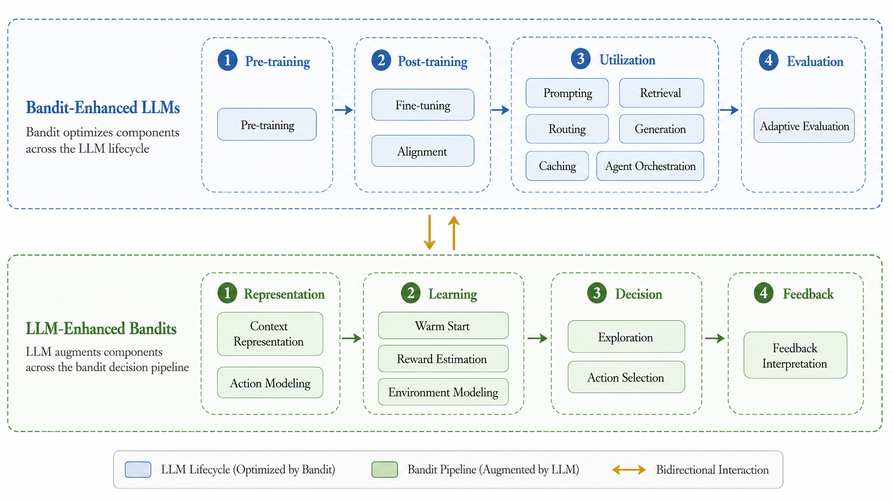

# 从“参考图”到“可编辑论文矢量图”：GPT \+ Codex \+ draw\.io 的 AI 辅助科研绘图工作流

## 1\. 背景与动机


在论文、综述、项目汇报和技术报告中，我们经常会遇到这样一种情况：看到一篇论文中的流程图、架构图或 taxonomy figure，觉得它的布局、配色、图标和整体视觉风格很好，希望自己的工作也能采用类似的表达方式。


传统做法通常是先分析参考图，再使用 PowerPoint、Visio、draw\.io、Illustrator 等工具一点一点复刻。这种方法最终效果可控，但有两个明显问题：


1. 需要花大量时间搭建布局、调整线条、统一颜色和字体；

2. 如果原始架构比较复杂，仅仅完成第一版草图就可能需要很长时间。

    

现在可以把这一过程拆解成：


> **AI 负责理解、构图和生成初稿，人负责审美判断、语义校验和最后的精细调整。**
> 
> 


一个比较实用的工作流是：


**参考优秀论文图片 → GPT 理解风格 → GPT 生成自己工作的示意图 → Codex \+ draw\.io 将示意图重构为原生矢量图 → 替换高质量 SVG 图标 → 人工微调 → 导出 SVG/PDF/PNG**


这样可以把最耗时间的“从空白画布开始搭框架”交给 AI，而我们只负责最后的精修。


---


## 2\. 整体工作流

整个流程可以分成三个大的阶段：

|阶段|核心任务|推荐工具|输出|
|---|---|---|---|
|概念设计|梳理自己的工作结构，并提取参考图风格|GPT|图的逻辑结构、绘图 prompt|
|视觉原型|按照参考图风格生成自己的示意图|GPT 图像生成|PNG/JPG visual prototype|
|正式绘制|将视觉原型重构为可编辑矢量图|Codex \+ draw\.io|`.drawio`、SVG、PDF、PNG|

最重要的一点是：

> **GPT 生成的图片应该被理解为“视觉原型”，而不是最终论文图片。**
> 
> 


---


## 3\. 第一步：先让 AI 帮我们把“要画什么”想清楚

在正式绘图之前，不建议直接给 AI 一段论文，然后要求：

> “帮我画一个漂亮的架构图。”
> 
> 

这样得到的结果通常信息层次比较混乱。

更好的方式是先让 GPT 对研究内容进行一次**视觉结构化**。

例如，可以告诉 GPT：

- 我的工作包含哪些阶段？

- 哪些模块属于并列关系？

- 哪些模块属于前后流程？

- 哪些是输入？

- 哪些是输出？

- 哪些是控制关系？

- 哪些是反馈关系？

然后让 GPT 给出类似下面的结构：


```Plain Text
Input
  ↓
Representation
  ↓
Decision
  ↓
Execution
  ↓
Feedback
  └────────→ Decision Update
```

或者：

```Plain Text
Stage 1
 ├─ Component A
 └─ Component B

Stage 2
 ├─ Component C
 ├─ Component D
 └─ Component E
```

这一步的目标并不是画图，而是确定：

> **这张图真正想向读者传递什么信息。**
> 
> 

---

## 4\. 第二步：寻找一张我们喜欢的参考图

接下来可以从论文、综述、会议 slides 或其他学术资料中寻找视觉风格喜欢的图片。

我们需要关注的并不是参考图具体写了什么，而是它的“视觉语言”，例如：

|观察维度|可以分析的内容|
|---|---|
|Layout|横向、纵向、分栏、环形、层级式|
|Grouping|实线框、虚线框、大区域、小模块|
|Color|主色、辅助色、浅色背景|
|Typography|字体、粗体、斜体、字号层次|
|Icon|outline / filled / flat / illustration|
|Connector|实线、虚线、箭头、feedback loop|
|Spacing|模块留白、区域间距|
|Hierarchy|Stage、Component、Sub\-component 如何区分|

例如，一种很典型的学术综述风格是：

> 白色背景 \+ 黑色细边框 \+ 虚线分组框 \+ 少量低饱和颜色 \+ 简洁 icon \+ 清晰的横向流程。
> 
> 


---

## 5\. 第三步：把参考图和自己的内容同时交给 GPT

接下来，将：

**参考图片 \+ 自己工作的结构**

同时发送给 GPT。

可以要求：

> “参考这张论文图的视觉风格，但不要复制其中的内容。使用我的研究结构重新设计一张图。”
> 
> 

例如：

```Plain Text
请参考这张图片的学术绘图风格：

- 白色背景
- 分区域虚线框
- Times New Roman
- 圆角矩形
- 低饱和配色
- 简洁 SVG 风格图标
- 清晰箭头
- 横向流程

请使用下面的研究结构重新生成一张新的架构图：

Input
→ Prompting
→ Retrieval
→ Routing
→ Generation
→ Response

Caching 位于主流程上方；
Agent Orchestration 位于主流程下方并协调多个模块。

不要复制参考图中的内容，只参考它的设计语言。
```

经过几轮调整以后，通常能够得到一张视觉上比较完整的示意图。



---

## 6\. 为什么 GPT 生成的图片不建议直接放进论文

AI 生成的图即使视觉效果已经很好，通常仍然不适合作为论文最终图。

最主要的问题是它通常还是一张**栅格图片**：

```Plain Text
PNG / JPG
```

而论文正式图更理想的是：

```Plain Text
SVG / PDF / EPS
```

两者最大的区别在于可编辑性和缩放能力。

栅格图片放大之后可能出现边缘模糊，尤其是图中文字、细线和小图标；而且无法直接修改某一个框、某一条箭头或者某一段文字。AI 生成的文字和 icon 也可能出现微小畸变、不一致或不准确。某些生成平台或导出链路还可能附带平台标识、水印或相关元数据。

因此：

> **AI 图片最适合充当 layout prototype，而不是 publication\-ready source file。**
> 
> 

传统解决方案当然是：

> 打开 draw\.io / PPT / Illustrator，然后照着 AI 图片重新画一遍。
> 
> 

但这样又回到了最开始的问题：

**费时间。**

---

## 7\. 关键步骤：让 Codex 自动完成“人工临摹”

这里就是整个工作流效率提升最大的地方。

我们可以：

> 把 GPT 生成的示意图交给 Codex，然后让 Codex 调用 draw\.io 的相关能力，将它重新构造成真正的 `.drawio` 图。
> 
> 

draw\.io 提供面向 Codex / AI 客户端的集成方式，包括 Plugin / Skill 和 MCP。对于本地 Codex 科研绘图，一般使用：

> **Codex \+ draw\.io Plugin/Skill \+ draw\.io Desktop**
> 
> 

就已经足够。

常见两种路线：

|方案|推荐场景|
|---|---|
|Codex \+ draw\.io Plugin/Skill|本地科研绘图，最推荐|
|AI Client \+ draw\.io MCP|希望让 AI 直接调用 MCP diagram tools|

---

## 8\. 环境安装

### 8\.1 安装 draw\.io Desktop

draw\.io Desktop 是免费的桌面应用，可以在 GitHub Releases 中下载 Windows、macOS 和 Linux 版本。

地址：

https://github\.com/jgraph/drawio\-desktop/releases

安装 Desktop 的主要作用是：

> **让 Codex 在本地生成 ****`.drawio`**** 后进一步导出 SVG / PDF / PNG。**
> 
> 

---

### 8\.2 给 Codex 安装 draw\.io Plugin

可以参考 draw\.io 官方仓库：

https://github\.com/jgraph/drawio\-mcp

Codex 中可以安装 draw\.io plugin，并通过类似下面的方式调用：

```Plain Text
/drawio:drawio
```

例如：

```Plain Text
/drawio:drawio create a flowchart for model routing
```

如果只是本地使用 Codex 生成和修改 `.drawio`，通常没有必要同时安装 MCP。

---

## 9\. Skill 和 MCP 应该选哪个？

不需要两个都装。

对于本地 Codex 科研绘图：

> **Codex Plugin / Skill \+ draw\.io Desktop 已经足够。**
> 
> 

MCP 更适合需要让支持 MCP 的客户端直接调用 diagram tools、shape search 等场景。

因此，如果只是：

> “给 Codex 一张 PNG，然后让它生成 `.drawio`。”
> 
> 

一般可以先用 Plugin/Skill。

---

## 10\. 第四步：让 Codex 根据 AI 示意图重绘

假设：

```Plain Text
figures/reference.png
```

就是 GPT 生成的示意图。

可以给 Codex：

```Plain Text
/drawio:drawio

参考 `figures/reference.png`，
将其重新绘制为原生、完全可编辑的 draw.io 矢量图。

要求：

- 忠实保留原图的信息结构；
- 保留模块关系、箭头、分组和文字；
- 不允许直接嵌入 reference.png；
- 所有框使用 draw.io 原生 shape；
- 所有文字使用原生 text；
- 所有连接关系使用原生 connector；
- 所有分组框使用 draw.io 原生 shape；
- 字体统一为 Times New Roman；
- 尽量保持参考图中的空间比例；
- 输出 figures/result.drawio；
- 同时导出 figures/result.svg；
- 如果支持，同时导出 figures/result.pdf。

参考图片是 layout specification，
不要根据自己的理解重新设计整个结构。
```


第一版往往已经可以完成：

- 模块位置；

- 边框；

- 分组；

- 文字；

- 箭头；

- feedback loop；

- 颜色；

- 对齐；

- 大部分布局。

这就省掉了大量机械绘图工作。

---

## 11\. 最容易出现的问题：图标不够精美

这是实际测试中一个非常典型的问题。

Codex 可以很好地重建：

```Plain Text
rectangle
connector
text
group
dashed frame
```

但如果要求它“自己画一个机器人 icon”“自己画一个 routing icon”，模型可能会使用：

```Plain Text
圆
矩形
箭头
线条
```

拼成一个类似图标的东西。

结构没有错，但视觉质量通常不如成熟 icon library。

因此更好的原则是：

> **架构由 Codex 画，图标由专业 SVG library 提供。**
> 
> 

---

## 12\. 第五步：寻找真正的 SVG 图标

可以使用一些免费、统一风格的 SVG icon library。

### Lucide

https://lucide\.dev/

特点：

- 统一线性风格；

- 可以调整颜色和 stroke；

- 很适合论文架构图。

### Tabler Icons

https://tabler\.io/icons

特点：

- 大量 SVG icon；

- outline 风格统一；

- 很适合科研流程图。

例如：

|模块|可以搜索的 SVG 关键词|
|---|---|
|Dataset|database / files|
|Training|chart / activity|
|LLM|bot / brain|
|Retrieval|search / file\-search|
|Routing|route / network|
|Generation|sparkles / cpu|
|Cache|database / archive|
|Agent|bot / workflow|
|Reward|gauge / chart|
|Feedback|message / activity|

尽量让**整张论文使用同一个 icon family**。

---

## 13\. 甚至可以让 Codex 自己寻找 SVG

也可以直接告诉 Codex：

```Plain Text
不要使用 draw.io primitive 拼接模拟图标。

请优先从外部检索合适的现成 SVG 图标。

优先级：

1. Lucide
2. Tabler
3. Material Symbols

尽量整张图只使用一个 icon family。

例如：

Retrieval → file-search
Routing → route
Caching → database
Agent → bot / workflow

将下载的 SVG 保存到：

figures/icons/

如果找不到合适图标，
请保留 placeholder，不要自行拼接替代。
```

这样最终项目可以形成：

```Plain Text
figures/
│
├── reference.png
├── architecture.drawio
├── architecture.svg
├── architecture.pdf
│
└── icons/
    ├── database.svg
    ├── search.svg
    ├── route.svg
    ├── bot.svg
    └── workflow.svg
```

---

## 14\. 第六步：在 draw\.io Desktop 做最后精修

Codex 最有价值的地方是：

> **把 0 → 80% 的绘图工作自动完成。**
> 
> 

但最后的精修仍然推荐人工完成。

通常需要调整的是：

|类型|常见调整|
|---|---|
|Alignment|两个框是否完全对齐|
|Spacing|模块间距是否统一|
|Typography|字号、Bold、Italic|
|Icon|大小是否一致|
|Connector|是否穿过文字|
|Color|色调是否统一|
|Padding|框中文字是否太挤|
|Canvas|是否存在大量无效空白|

这个阶段已经不再是“重新画图”，而只是：

> 微调。
> 
> 

---

## 15\. 第七步：正式导出

最终建议同时保存三类文件。

### 源文件

```Plain Text
figure.drawio
```

用于未来修改。

### 论文版本

```Plain Text
figure.pdf
```

或者：

```Plain Text
figure.svg
```

它们是矢量格式，适合论文排版。

### 预览版本

```Plain Text
figure.png
```

用于：

- 微信；

- PPT；

- README；

- GitHub；

- 快速预览。

## 16\. 一个推荐的项目目录

科研项目中最好把源图、参考图和导出文件分开管理：

```Plain Text
project/
│
├── figures/
│   │
│   ├── references/
│   │   ├── style_reference_1.png
│   │   └── gpt_prototype.png
│   │
│   ├── source/
│   │   ├── architecture.drawio
│   │   └── pipeline.drawio
│   │
│   ├── icons/
│   │   ├── database.svg
│   │   ├── search.svg
│   │   ├── route.svg
│   │   └── bot.svg
│   │
│   └── export/
│       ├── architecture.pdf
│       ├── architecture.svg
│       └── architecture.png
```

---

## 17\. 推荐的三轮 AI 绘图策略

不要期待“一句话生成完美论文图”。

更有效的是分三轮。

### 第一轮：结构正确

目标：

> 模块、流程、关系全部正确。
> 
> 

此时不要纠结 icon。

### 第二轮：布局统一

要求 AI：

> 对齐、等距、统一尺寸、减少交叉箭头、缩小无效留白。
> 
> 

### 第三轮：视觉精修

最后处理：

> 字体、SVG icon、颜色、stroke width、padding。
> 
> 

这样会比不断要求：

> “重新给我生成一张更好看的”
> 
> 

稳定得多。


---

## 18\. 一个可以复用的 Codex 通用提示词

以后几乎所有论文图都可以从下面这个模板开始：

```Plain Text
/drawio:drawio

请参考：

`figures/reference.png`

将该示意图重新绘制为一张原生、完全可编辑的 draw.io 矢量图。

核心目标：
忠实复现参考图中的信息结构、布局、模块关系、箭头、分组、相对尺寸和视觉层级，同时将其重构为真正可编辑的 draw.io 图。

要求：

1. 不要嵌入参考 PNG；
2. 模块框使用 draw.io 原生 shape；
3. 文字使用 draw.io 原生 text；
4. 箭头使用 draw.io 原生 connector；
5. 分组框使用 draw.io 原生 shape；
6. 所有字体统一为 Times New Roman；
7. 尽量保持参考图片中的空间比例；
8. 不要根据自己的理解重新设计原有逻辑；
9. 相同层级的模块保持统一尺寸和间距；
10. 避免箭头穿过文字和模块。

图标要求：

不要使用 draw.io 的基本几何图形自行拼接模拟图标。

请优先从外部寻找合适的现成 SVG：

1. Lucide
2. Tabler
3. Material Symbols

尽量整张图只使用一个 icon family。

保存至：

`figures/icons/`

如果无法找到合适的 SVG，
保留 placeholder，不要自行拼接替代。

输出：

`figures/result.drawio`
`figures/result.svg`

如果支持，同时输出：

`figures/result.pdf`

完成后检查：

- 模块是否遗漏；
- 连接关系是否正确；
- 是否存在重叠；
- 字体是否统一；
- 图标是否为 SVG；
- connector 是否穿过文字；
- SVG/PDF 是否可以正常导出。

如果第一版与参考图差异较大，
请继续修改同一个 draw.io 文件，而不是重新生成位图。
```


